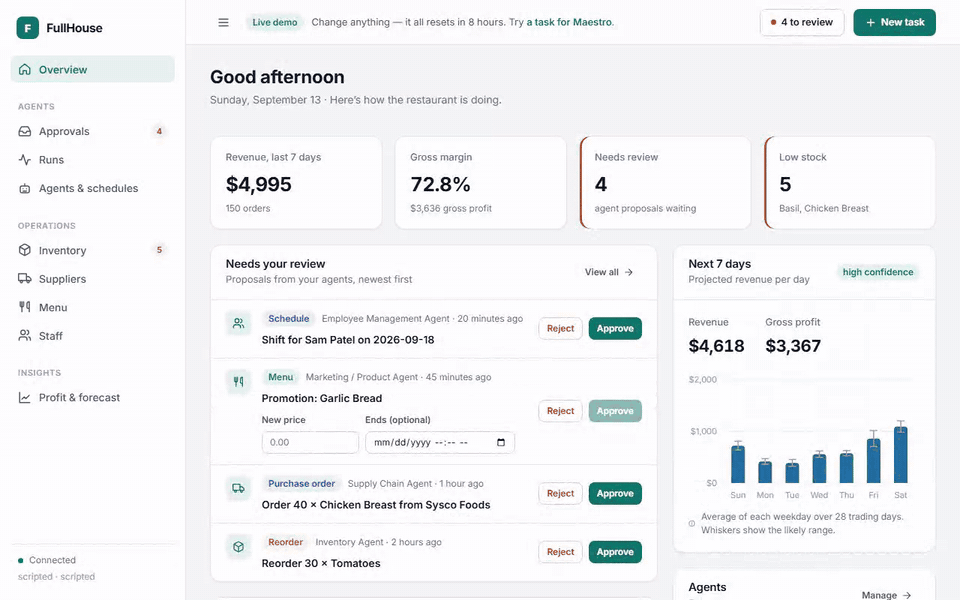
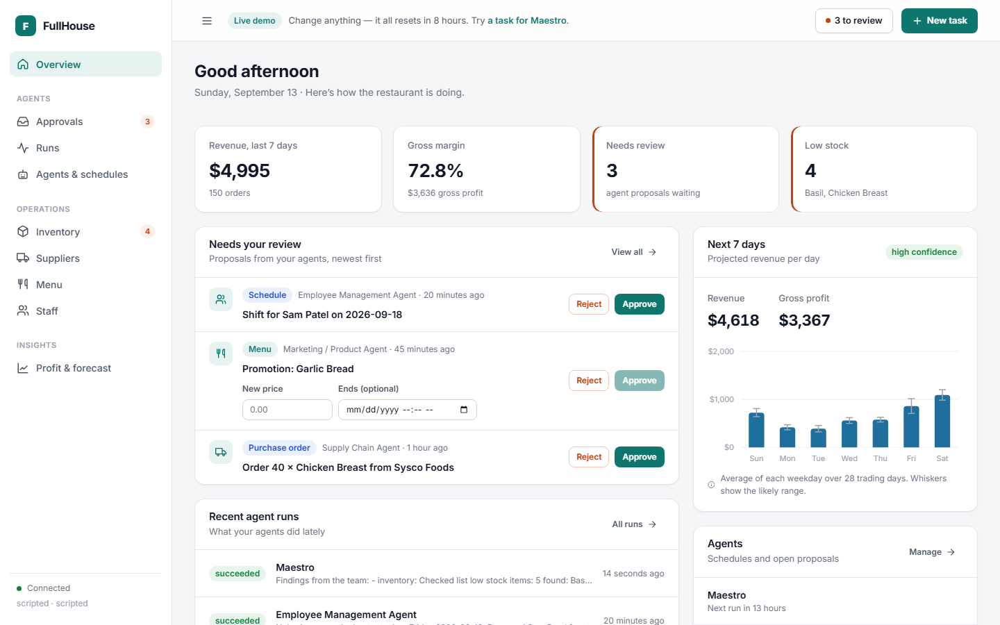
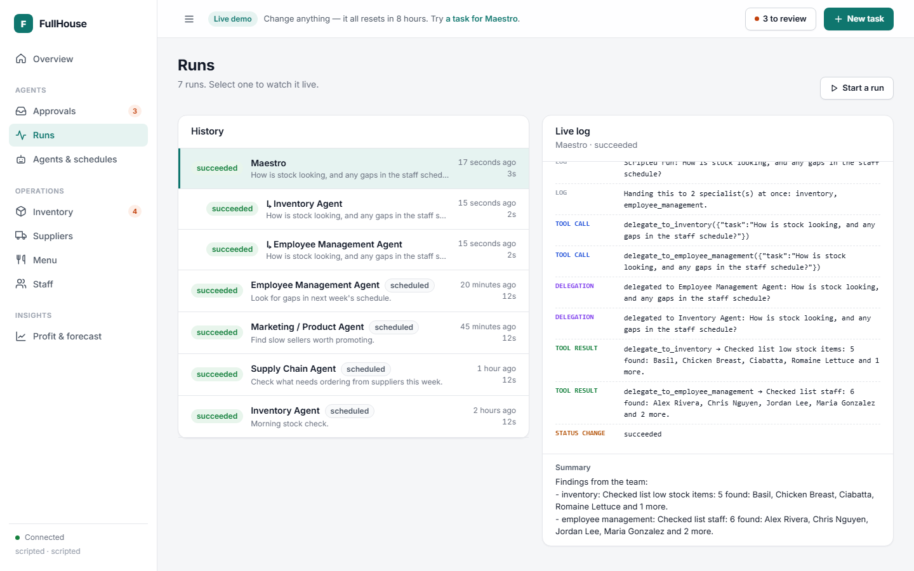
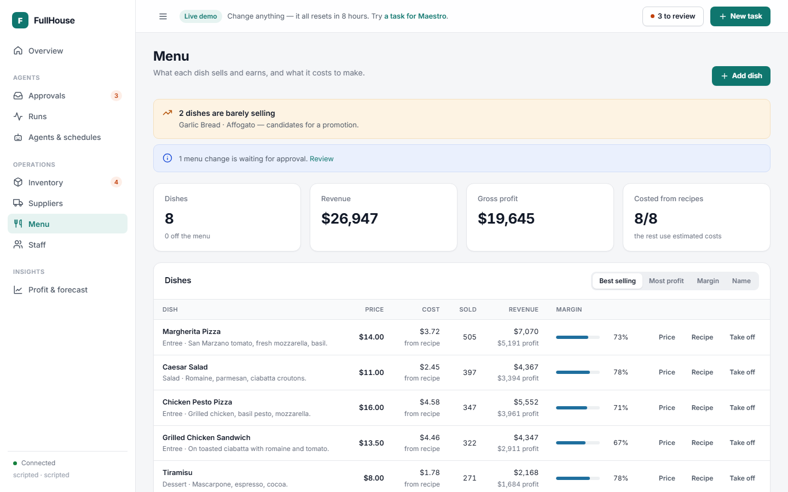
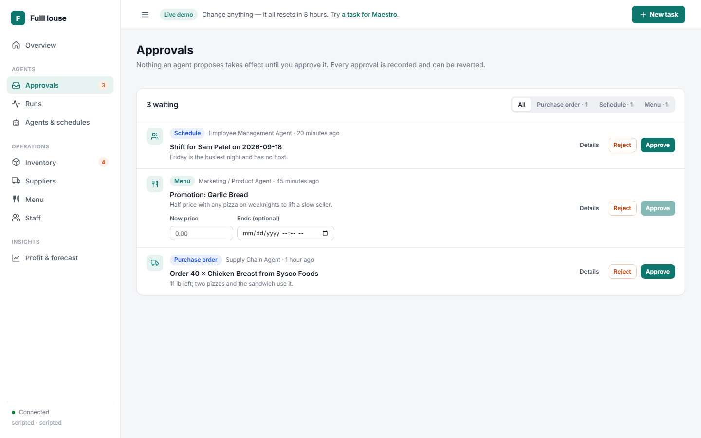
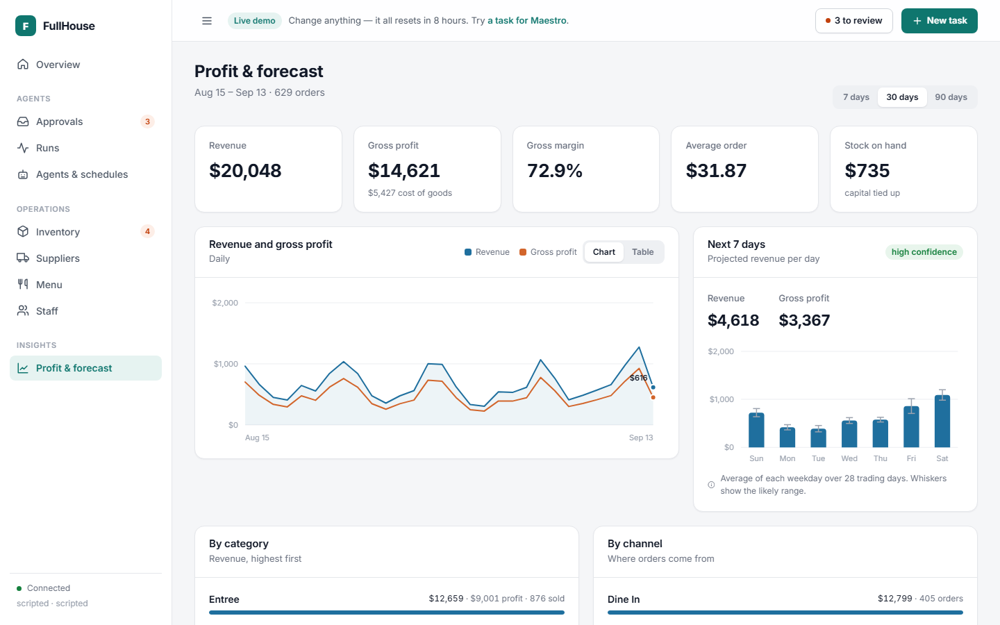
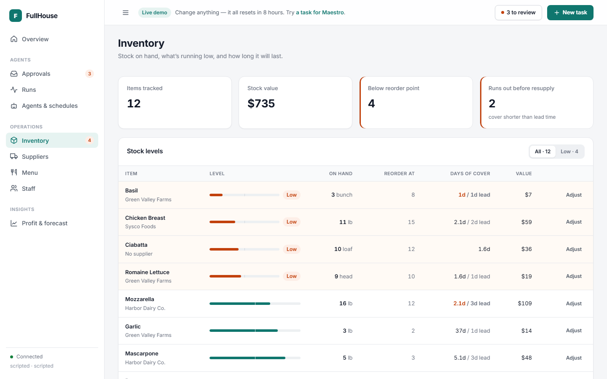
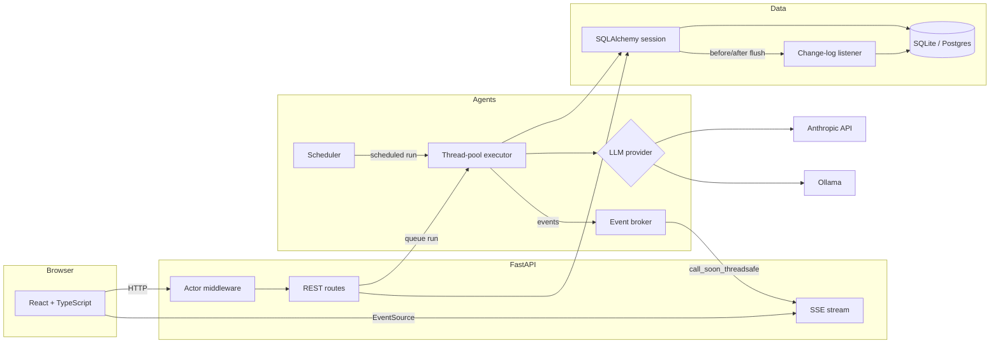

# FullHouse

**Price intelligence for small restaurants: it reads your supplier invoices and tells you, once a week, what changed, what it cost you, and what to do about it.**

[](https://github.com/eddierzhang/FullHouse-Built/actions/workflows/ci.yml)


[](LICENSE)

An owner-operator with two or three broadline distributors and a few single-source ones gets a bill a day and no time
to compare them. FullHouse takes the invoices (a Bill.com export, forwarded email, a phone photo typed up, or pasted
text), matches every printed line to one canonical item with its pack size, and on Monday sends one digest: dollars at
stake this week, then three lists in fixed order. **Switch supplier**, **Price went up**, **Owed to you**. Each card
names the item, the supplier and the dollars, and has one button: move the item, or draft the message to the rep.

One agent does the reading, matching, drafting and answering. When it isn't sure what a line is, it asks a one-tap
question instead of guessing, at most five a week. It never places an order, changes a supplier, sends anything, pays
anything or edits an invoice, and it never says a price is "wrong", only that it changed or that someone charged less.

> FullHouse started as a hackathon project — the original version is at
> [eddierzhang/FullHouse](https://github.com/eddierzhang/FullHouse). Its first product, an operations dashboard with
> inventory, schedule, menu and profit pages run by the same agent, is the main dashboard; the price pages sit
> beside it under **Invoices & prices**.



## Try it

No API key, GPU or model download needed — the demo runs its agent on a deterministic scripted provider, loads a
small Italian bistro with eight weeks of supplier invoices (and six weeks of trading for the operations pages), and
resets itself daily.

```bash
docker compose -f docker-compose.demo.yml up --build     # then open http://localhost:8080
```

Without Docker: `python dev.py setup` once, then `python dev.py demo`.

For real use, no key is required. With none, the assistant answers price questions by rule from the invoices and
PDFs are read by rule. A model adds free-form answers and the reading of invoice photos: `ANTHROPIC_API_KEY` for
Claude, or `LLM_API_KEY` for a free Gemini key, Groq, or any OpenAI-compatible API. The Monday digest is mailed
from any mailbox over SMTP (a Gmail address with an app password, free) or through Resend, and printed to the log
with neither; the four `BILLCOM_*` values pull bills from Bill.com. All optional; `backend/.env.example` describes
each.

Or put your own copy online, free and without a card, on Render's free plan:

[](https://render.com/deploy?repo=https://github.com/eddierzhang/FullHouse-Built)

It reads [`render.yaml`](render.yaml), builds the single-container image and serves the same demo. The free plan
sleeps after 15 idle minutes and wakes in about a minute, starting from a fresh restaurant each time. Other hosts,
and running it for real rather than as a demo, are in [DEPLOY.md](DEPLOY.md). That includes a free private instance
with no card and no key anywhere: one Render service for any number of restaurants, Neon Postgres, the Monday
digest from a Gmail address, and the assistant rule-based or on Gemini's free tier
([`render.customer.yaml`](render.customer.yaml)).

| Overview | The agent's run, live | Menu costed from recipes |
|---|---|---|
|  |  |  |
| **Approvals** | **Profit and forecast** | **Inventory and days of cover** |
|  |  |  |

The screenshots above are of the operations pages; the design for the price screens is in
[docs/design](docs/design).

---

## What it does

- **Reads invoices as printed.** Every line is kept exactly as the supplier printed it: description, quantity, pack,
  price. Matching sets which canonical item it is and how many units one pack holds, so a 24-count case from one
  supplier and a "KALE GRN 24CT" from another become the same price per unit. A confirmed match is remembered per
  supplier and never asked again. ([engine.py](backend/app/prices/engine.py))
- **Asks instead of guessing.** A line the agent can't place becomes one question with two tap answers and "Something
  else": the invoice crop, the question, nothing more. Questions are ordered by the line's dollars, capped at five a
  week per restaurant; the rest wait. The first question after the first invoice is the whole tutorial.
- **One digest a week.** Dollars at stake, then Switch supplier (food, dry goods and paper only), Price went up, and
  Owed to you (billed more than delivered, no credit yet). Ranked by dollars, ten cards at most, the rest behind
  "N smaller items". Items with fewer than two matched invoices get no card and no recommendation; the item page says
  "Not enough matched invoices to compare yet." There are no confidence numbers anywhere.
- **Answers from the invoices.** Ask from any screen: "what did I pay for tomatoes last month", "how much did Harbor
  Dairy short me this quarter", "talking points for tomorrow's meeting". Two sentences with the numbers, then chips for
  the invoices and items it used. An answer without a source isn't allowed. Meeting prep comes straight from the
  digest, five lines in the owner's words.
- **Drafts the message, you send it.** Price challenge or credit claim: three sentences and the invoice lines cited,
  addressed to the rep it remembers per supplier. Send via email opens your own mail app after a confirm sheet; there
  is no auto-send and no send-later.
- **"Not useful" is the only feedback.** It hides the item from the digest for four weeks. "Move kale" records your
  decision so the next digest checks the invoice for it; nothing is ordered.
- **Stock that follows the invoices.** Each item on the invoices is counted as an Inventory item (matched by name,
  or chosen by the owner). A confirmed invoice books its deliveries into stock, and an item at its reorder point gets
  a purchase order proposed from the cheapest recent supplier, in whole packs, with the cost, for an owner to approve.
- **Orders followed to the door.** Approving a reorder places an order, not a delivery. It sits under On order with its
  expected date, can be marked shipped, shows as overdue, and is booked into stock when it is received, by hand with
  what actually arrived or by the invoice for it. Nothing is sent to a supplier.
- **A bookkeeper view.** An accountant invited as a bookkeeper sees a table of clients (questions outstanding, last
  digest, dollars flagged this month) and answers the agent's questions for any of them. The owner sees the question
  resolved, not who resolved it.
- **The operations platform.** The inventory, schedule, recommendations, customer requests, menu, profit and
  history pages from the first product are the main dashboard, with the same agent and the same complete,
  revertible change history. Nothing in the price product counts inventory, sets par levels or automates purchasing.

## Architecture



## Engineering notes

The decisions that took the most thought, and why:

**Change tracking lives in the ORM, not in the routes.** A session listener captures every write, so no code path —
a REST handler, an agent tool, a seed script — can change data unrecorded. Capture is split across two events: prior
values are read in `before_flush`, the only point they're still knowable, and inserts in `after_flush`, the only point
a new row has its primary key. SQLAlchemy's `active_history` has to be switched on, because a commit expires attributes
and the old value of a later edit would otherwise be silently recorded as null.
([listener.py](backend/app/audit/listener.py))

**Streaming crosses a thread boundary.** Agent runs use synchronous clients (SQLAlchemy, the Anthropic SDK, httpx), so
they run on a thread pool, while server-sent events are served on the asyncio loop. A small broker hops each event back
onto the loop with `call_soon_threadsafe`. Streams replay recorded events before going live, so a late listener still
sees the whole run. ([broker.py](backend/app/agents/broker.py))

**Cancellation is cooperative.** Providers check between tool rounds rather than killing a thread mid-write, and runs
orphaned by a server restart are marked failed on startup instead of claiming to be in progress forever.

**One agent, every tool.** The Assistant Manager replaced a team: an orchestrator, Maestro, used to hand work to five specialists, each in its own run. Now it holds all their
tools itself, grouped by area, and picks the ones a request needs: no delegation round-trips, one run to follow, and a
proposal that spans stock, suppliers and shifts comes out of a single run. The owner's daily stock check is a scheduled
job that asks the same agent a set question. ([registry.py](backend/app/agents/registry.py))

**Slow local runs were model reloads, not inference.** Profiling showed ~140 tokens/s and sub-second calls, but 10–16s
of load time on nearly every call: Ollama reloads a model whenever a request asks for a different context size than
the loaded copy, and unloads it after five idle minutes. Every request now pins `num_ctx` and `keep_alive`.

**Numbers say what they rest on.** The forecast switches from a daily average to weekday means only with two weeks of
history, and reports its confidence. "Days of cover" is blank, not zero, where no recipe links an item to sales.

**Timezones were a real bug.** The profit chart's daily series once summed to less than the headline revenue: days were
bucketed by local date while timestamps were stored in UTC. Everything is UTC now, and Postgres sessions are pinned to
`GMT` — which, unlike `UTC`, every Postgres build has without a timezone database. A second one surfaced while recording
the demo: SQLite returns timestamps without an offset, so the API sent them without one and a browser west of UTC showed
a run from a minute ago as "in 7 hours". A column type now attaches UTC on the way out of either database.
([types.py](backend/app/db/types.py))

## Agent evaluation

Six scenarios run each agent through the real pipeline against a throwaway database, then score what it *did*: which
tools it called, whether it made the right proposal, whether that proposal would actually apply (applied, then rolled
back), and — in two negative scenarios — whether it correctly did nothing.

| Scenario | `qwen3.5:4b` | `qwen2.5:7b` | do-nothing baseline |
|---|---|---|---|
| Stock shortage | 100% | 100% | 60% |
| Nothing low *(should propose nothing)* | 100% | 100% | 100% |
| Slow-selling dish | 80% | 80% | 40% |
| Purchase order from the right supplier | 100% | 40% | 60% |
| Cover a staffing gap | 100% | 20% | 60% |
| Profit report *(read-only)* | 100% | 100% | 100% |
| **Overall** | **97%** | **73%** | **70%** |

The baseline matters: an agent that never acts scores 70%, so that's the floor to beat. The smaller model beat the larger
one, which proposed orders and shifts for the wrong items. Both left prices off their promotions, which is why the
approval queue asks for them. One run per scenario, so treat small differences as noise.
Full report: [evals/results/latest.md](backend/evals/results/latest.md).

## Tech stack

**Backend** — Python 3.11, FastAPI, SQLAlchemy 2.0, Alembic, Pydantic v2, APScheduler, psycopg 3, Anthropic SDK, httpx
**Frontend** — React 19, TypeScript, Vite, hand-built SVG charts, no UI framework
**Data** — SQLite locally, Postgres supported and tested
**Models** — Anthropic Claude, any OpenAI-compatible API (Gemini, Groq, OpenRouter), or local models through Ollama
**Quality** — pytest (210 tests on SQLite and Postgres), Playwright end-to-end tests, agent evals, GitHub Actions
**Delivery** — a single-container demo image, and Docker Compose with nginx and Ollama

## For restaurants

- [docs/USER_GUIDE.md](docs/USER_GUIDE.md): a short guide for owners and staff (also in the app, under Help).
- [docs/PILOT.md](docs/PILOT.md): the checklist for running a pilot with the first restaurant.
- [DEPLOY.md](DEPLOY.md): deploying, error alerts (Sentry), backups, and rolling back.

## Running it

Every task is one command through [`dev.py`](dev.py), which works the same on Windows, macOS and Linux:

| Command | What it does |
|---|---|
| `python dev.py setup` | Creates the virtualenv, installs both halves, migrates and seeds a database |
| `python dev.py dev` | API on :8000 and frontend on :5173, together |
| `python dev.py demo` | The public demo on :8080 |
| `python dev.py test` | Backend tests, then a frontend type-check and build |
| `python dev.py e2e` | Playwright end-to-end tests against an isolated stack |
| `python dev.py eval --targets ollama:qwen3.5:4b scripted` | Agent evaluation |

`LLM_PROVIDER` in `backend/.env` picks what runs the agents: `ollama` (needs [Ollama](https://ollama.com) and a
tool-capable model), `anthropic` (needs `ANTHROPIC_API_KEY`), `openai` (needs `LLM_API_KEY`; a free Gemini key
from [AI Studio](https://aistudio.google.com/apikey) works as-is), or `scripted`, which `setup` chooses so the app works
straight away. Left empty, it follows whichever key is set, and with no key it is `scripted`: the app needs no key.

For Ollama, don't share the server with other heavy workloads — a competing request for the same model with different
settings makes Ollama reload it.

### With Docker and a local model

```bash
cp .env.docker.example .env
docker compose up -d --build        # nginx, the API and Ollama; the first start downloads the model
```

Open http://localhost:8080. [DEPLOY.md](DEPLOY.md) covers hosting it on a free VM.

### Postgres

The suite runs against Postgres in CI. Locally: `TEST_DATABASE_URL=postgresql://... python -m pytest` from `backend/`.

## Project layout

```
backend/
  app/agents/       runner, executor, broker, scheduler, appliers, providers, tools
  app/audit/        change-log listener, actor context, revert
  app/restaurant/   domain models, aggregates (profit, forecast, supply chain), routes
  app/demo.py       the demo restaurant and its reset
  evals/            scenarios, harness, results
  tests/
frontend/
  src/pages/        one component per page
  src/components/   shared UI: approvals list, charts, drawer, recipe editor
  e2e/              Playwright tests
  scripts/          records the demo GIF and screenshots
docs/               user guide, pilot checklist, development log, original plan, screenshots
Dockerfile          single-container image (demo, free hosts)
docker-compose.yml  nginx + API + Ollama
dev.py              developer tasks
```

## Limitations

- **One site, one AI key.** With `ALLOW_SIGNUP=true` any number of restaurants can sign up from the landing page,
  each with separate data, team and agent schedule, but they all run their agents on the site's one model
  provider and key, with no per-restaurant limit or billing. Signup is off by default, which keeps a site to one
  restaurant; see [DEPLOY.md](DEPLOY.md) for that, and its Security section for roles, invites and two-step sign-in.
- **Single process.** The event broker and scheduler live in the API process, so it can't be scaled horizontally without
  moving them to something like Redis.
- **Gross, not net.** Profit excludes labour and overheads.
- **No purchase-order lifecycle.** Approving a reorder books the goods as received immediately.
- **Reading photos needs a model.** A photo of an invoice is read into lines by Claude (`ANTHROPIC_API_KEY`) or by a
  vision model on the OpenAI-compatible API (`LLM_API_KEY`, Gemini for one). A PDF that carries text is read by rule
  with any model or none; a scanned PDF, or a photo on a site with no model, is typed up. The demo's scripted reader
  reads only the PDFs the app wrote itself. There is no mailbox: forwarded email is pasted in. Whatever is read is checked (lines add to the total, quantity × price is the line total, nothing read
  with doubt) and an invoice that fails a check waits for "Looks right" before it counts.
- **Bill.com is untested against the real sandbox.** The v3 client (`backend/app/prices/billcom.py`) signs in, pages
  bills with their line items and vendor names, and saves each once; it has run against a stub only. One Bill.com
  organisation per site, from `BILLCOM_*` in the environment. Webhooks are received, not registered: subscribe to
  bill.created and bill.updated in the Bill.com developer portal and point them at
  `POST /api/v1/prices/billcom/webhook` with `X-Billcom-Secret`.
- **Outbound mail is the digest only.** The Monday digest goes out from a mailbox over SMTP (`SMTP_*`, a Gmail app
  password will do) or with Resend (`RESEND_API_KEY`), and without either to the server log. "Send via email" to a rep still opens a prefilled message in your own mail app and records that
  you sent it; the agent never sends anything.

## License

[MIT](LICENSE). How it was built, phase by phase: [docs/devlog.md](docs/devlog.md).
